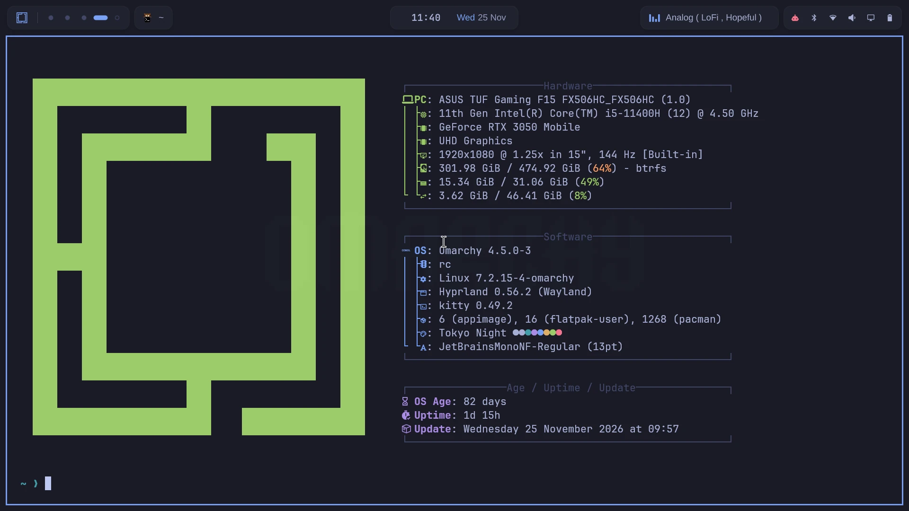
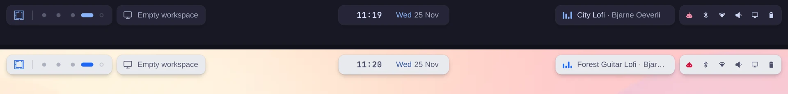
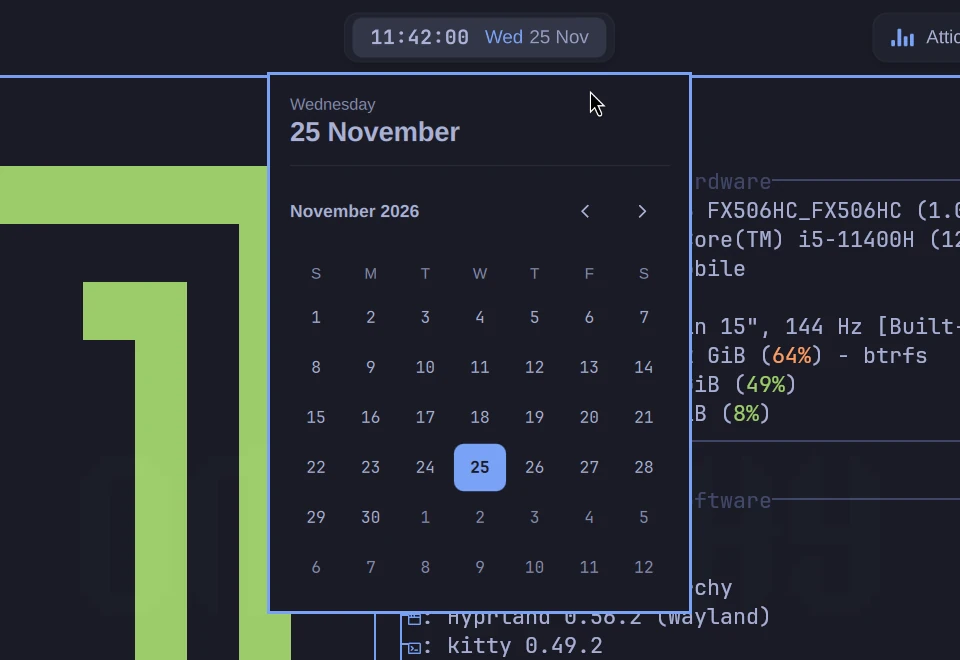
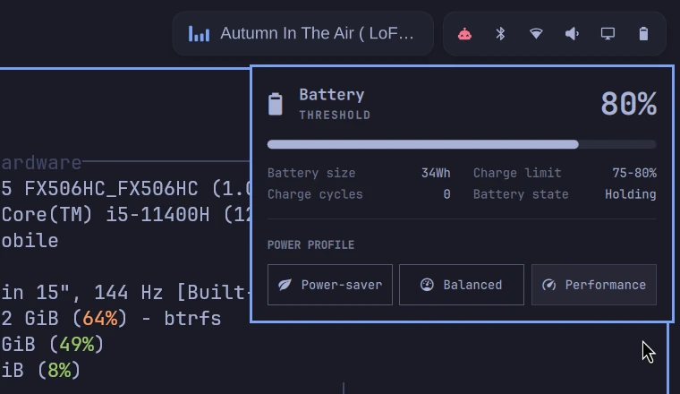
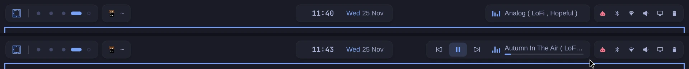

# Floating Islands

A native, theme-adaptive floating bar plugin for [Omarchy](https://omarchy.org), built with Quickshell and QML.

Floating Islands is a native `kind: "bar"` plugin written in QML and pure JavaScript that runs inside `omarchy-shell` with no background daemon or separate process. It is **not** a theme, wallpaper collection, dotfiles distribution, or standalone shell replacement: Omarchy retains ownership of themes, wallpapers, fonts, notifications, launcher, OSD, lock screen, and core system services, while Floating Islands adapts live to the active Omarchy theme and replaces only the bar presentation.



> **Status: Alpha / Pre-v1.0 development (manifest `0.1.0`, preparing initial public alpha).** Automated checks pass on CI (`qa` + `sandbox`), and single-display daily use has completed supervised live trials and persistent activation on Omarchy `4.5.0-3`. Multi-monitor sessions, suspend/resume, reboot restore, and the opt-in experimental Control Center (`bar.islands.controlCenter: false` by default) are still in progress. See [docs/ROADMAP.md](docs/ROADMAP.md) and [docs/TESTING.md](docs/TESTING.md).

## Native Theme Adaptation

Floating Islands binds its surfaces, accents, and transitions to Omarchy's `Commons.Color` and `Commons.Style` tokens — adapting live across dark and light Omarchy themes and routing animations through `Style.duration` so reduced-motion settings disable bar motion.



*Top: Catppuccin (Mocha) · Bottom: Catppuccin Latte — live theme switch with identical framing.*

## Key Interactions

| Native Calendar (`SUPER+CTRL+ALT+D`) | Native Hosted Widgets & Panels |
| :---: | :---: |
|  |  |
| Centered `KeyboardPanel` with seconds readout while open, month navigation, and keyboard / `Escape` dismissal. | Hosts stock and user-configured right-section widgets via `PluginBarApi` (`SUPER+CTRL+1..9` and one-panel-at-a-time handover).<sup>1</sup> |

<sub><sup>1</sup> The right status island renders whatever widgets are configured in the user's <code>bar.layout.right</code>. The screenshots above include two user-installed third-party status widgets alongside stock Omarchy widgets.</sub>

### Media Island (Compact & Expanded / Pinned)

Hover to preview or click to pin inline transport controls (`prev`, `play/pause`, `next`), equalizer, and playback progress — without redistributing third-party album artwork:



## Features

- **Floating island layout:** Launcher + workspace indicators, elastic active-window title with application icon, centered clock, dynamic media island, and a dedicated hosted status island — with per-output responsive tiers (`full`, `compact`, `minimal`) computed from measured widths rather than fixed pixel breakpoints.
- **Native Omarchy integration:**
  - Hosts stock and third-party right-section widgets via Omarchy's public `PluginBarApi` contract (`SUPER+CTRL+1..9` numbered shortcuts, `SUPER+CTRL+ALT+*` named shortcuts, and one-panel-at-a-time handover).
  - Binds to `Commons.Color` and `Commons.Style` (live dark/light theme adaptation, reduced-motion support, and `bar.position: "bottom"` support).
  - Uses the `omarchy-bar` layer-shell namespace, explicit `exclusiveZone`, and an island-only input mask without taking keyboard focus on the bar surface so clicks outside the islands pass through to windows beneath.
- **Native popouts & i18n:** Native Calendar panel (`SUPER+CTRL+ALT+D`), native Media island (hover preview + click pin), bar-drawn tooltips, and English (`en`), Spanish (`es`), and Japanese (`ja`) catalogs under `plugin/i18n/`.
- **Experimental Control Center (opt-in, work in progress):** Disabled by default (`bar.islands.controlCenter: false`). Grouped keyboard-accessible dashboard (Night Light, Stay Awake, Do Not Disturb, Pipewire audio output, Wi-Fi/Bluetooth toggles, UPower power profiles, and event-driven built-in display brightness) under active community design in [docs/CONTROL_CENTER_RFC.md](docs/CONTROL_CENTER_RFC.md).

## Installation, Trial & Recovery

Read [docs/RECOVERY.md](docs/RECOVERY.md) before activating the bar on a live desktop. Installation does not edit `shell.json`, and activation is always explicit.

### 1. Clone the repository

```bash
git clone https://github.com/adcuelloa/floating-islands.git
cd floating-islands
```

### 2. Install and run activation preflight

`scripts/install.sh` validates the plugin and copies it into `~/.config/omarchy/plugins/floating-islands` without changing the active bar. `scripts/activate.sh --check` verifies the upstream contract, QML lint, and running Hyprland/Omarchy session without touching configuration:

```bash
scripts/install.sh
scripts/activate.sh --check
```

*(Optional for contributors or extra pre-install verification: after one-time dev-only `pnpm install --frozen-lockfile --ignore-scripts`, `tests/run-all.sh` runs the full isolated test suite without touching anything outside `/tmp`. End-user installation and runtime never require Node.js, pnpm, or TypeScript.)*

### 3. Try temporarily with an automatic watchdog (recommended first step)

A default trial is scoped to the current Hyprland login session and rolls back automatically if initial IPC/geometry health checks fail. Adding `--watchdog 20` also sets a 20-minute wall-clock timer that runs `scripts/rollback.sh` to return the **stock Omarchy bar** (`omarchy.bar`) automatically:

```bash
scripts/activate.sh --confirm --watchdog 20
```

*Note: `--watchdog` always falls back to the stock Omarchy bar (`omarchy.bar`). If you are migrating from an existing supported legacy installation (`islands.bar`) and want to restore your exact prior configuration instead, use the pre-activation snapshot saved by `activate.sh` as documented in [docs/RECOVERY.md](docs/RECOVERY.md) (see also [docs/NAMING.md](docs/NAMING.md)).*

### 4. Persistent activation (deliberate opt-in)

Once you are ready to keep Floating Islands selected across logins, run persistent activation explicitly (it saves a timestamped pre-activation `shell.json` snapshot first):

```bash
scripts/activate.sh --confirm --persistent
```

### 5. Conditional shell restart after switching bar identities

When switching from `omarchy.bar` (or legacy `islands.bar`) to `floating-islands`, Omarchy's hot reload can leave hosted right-island widgets inactive until the shell restarts. If hosted widgets do not appear or respond after activation, run once:

```bash
omarchy restart shell
```

### 6. Stock-bar rollback & TTY recovery

To return to the stock Omarchy bar at any time (including from a TTY via `Ctrl+Alt+F3`, using only `bash`, `jq`, and coreutils), change into your repository clone (or invoke the script by its full path):

```bash
cd /path/to/floating-islands
scripts/rollback.sh
```

### Updating an already active installation

To update an existing `floating-islands` installation, pull the new revision and re-run `scripts/install.sh` (it stages a validated copy and replaces `~/.config/omarchy/plugins/floating-islands` without modifying `shell.json`), then run `omarchy restart shell` so updated bar QML takes effect (Omarchy's plugin reload does not rebuild an active bar's QML):

```bash
git pull
scripts/install.sh
omarchy restart shell
```

For testing development builds over a daily bar with automatic snapshot restore (`scripts/branch-test.sh`), see [docs/RECOVERY.md](docs/RECOVERY.md).

## Supported Compatibility Baseline & Alpha Limitations

Verified against:

- **Omarchy** `4.5.0-3` (`omarchy`, `omarchy-settings`)
- **Quickshell** `0.3.2`
- **Qt 6** `6.12.0` (`qt6-base`, `qt6-declarative`, `qt6-svg`, `qt6-wayland`)
- **Hyprland** `0.56.2`
- **Live desktop reference:** single display `1920×1080` at scale `1.25` (`1536×864` logical)

Compatibility is verified symbol by symbol rather than by strict version equality: run `tests/contract/check-contract.sh` to check whether your installed Omarchy tree satisfies every upstream API this bar uses. See [docs/COMPATIBILITY.md](docs/COMPATIBILITY.md) and [docs/TESTING.md](docs/TESTING.md) for the live vs. offscreen verification matrix.

**Current alpha limitations:**

- Multi-monitor layouts, suspend/resume cycles, and reboot auto-restore paths have not yet completed live hardware verification.
- Switching bar plugin identity via Omarchy hot reload requires one `omarchy restart shell` to initialize hosted widgets.
- Experimental Control Center is opt-in and incomplete (`bar.islands.controlCenter: false` by default).
- External DDC/CI monitor brightness and real AT-SPI screen-reader verification are pending.

## Settings

Configured under `bar.islands` in `~/.config/omarchy/shell.json` (hot-reloads automatically):

| Key | Values | Default |
|---|---|---|
| `density` | `compact` (40 px islands), `comfortable` (46 px) | `compact` |
| `tier` | `auto`, `full`, `compact`, `minimal` | `auto` |
| `timeFormat` | Qt time format string (legacy override / fallback when `omarchy.clock` is absent from `bar.layout`; cycling migrates to native `omarchy.clock` `format` in one write) | `omarchy.clock` `format`, else `HH:mm` |
| `customClockFormats` | bounded list (max 8) of retained user-defined custom clock formats preserved across cycling and restart (managed automatically) | `[]` |
| `showTitle` | boolean | `true` |
| `hostWidgets` | boolean: host stock right-section widgets | `true` |
| `hosted` | list of widget IDs to host instead of `bar.layout.right` | — |
| `extraHosted` | list of additional widget IDs (e.g., `["omarchy.elsewhen", "omarchy.weather"]`) | `[]` |
| `locale` | `auto`, `en`, `es`, `ja` (clock and calendar) | `auto` |
| `showMedia` | boolean: native media island | `true` |
| `mediaEqualizer` | `animated`, `static` | `animated` |
| `launcherIcon` | `omarchy` (Omarchy logo glyph), `grid` (generic app grid) | `omarchy` |
| `controlCenter` | boolean: experimental Control Center entry and panel | `false` |
| `titleIcon` | `app` (application icon with symbol fallback), `symbol` (monochrome symbol) | `app` |

`extraHosted` brings placed stock widgets from other sections into the status island without replacing `bar.layout.right`. They keep their named shortcuts (`SUPER+CTRL+ALT+E` for World Clock, `SUPER+CTRL+ALT+W` for Weather) without shifting `SUPER+CTRL+1..9`.

**Shortcuts & IPC:**
- Clock island: hover reveals seconds progressively; left-click toggles the native calendar (`SUPER+CTRL+ALT+D` / `omarchy.clock`); right-click cycles Omarchy's native horizontal format ring (plus retained custom formats) and persists through `updateEntryInline` / `mutateShellConfig`; middle-click opens `omarchy-menu-timezone`.
- `omarchy-shell omarchy.clock refresh|cycleFormat|toggleWeekStart|open|close|show|hide|toggle` restores native clock IPC parity (`weekStartDay` follows locale by default and persists Monday/Sunday toggles through the native clock entry).
- `omarchy-shell floating-islands toggleCalendar` / `toggleControlCenter` / `toggleMedia` toggle panels via IPC.
- `omarchy-shell floating-islands geometry` / `slots` / `tooltip` report read-only diagnostics.
- `bar.position: "bottom"` anchors islands to the bottom edge (left/right map to top).

## Architecture

Floating Islands separates pure logic from Quickshell views and system adapters:

```text
plugin/            Installable Omarchy plugin folder (id: floating-islands)
  manifest.json    Plugin metadata, kind "bar", entry point
  Bar.qml          Entry point, host contract, settings, trial mode, IPC
  core/            Per-output BarSurface, WidgetHosting, HostedBarApi, Identity
  geometry/        Layout.mjs — responsive tiers, exclusive zone, hit areas (native .mjs)
  theme/           Theme.qml (bound to Commons.Color/Style), Palette.js, Icons.js
  logic/           Pure logic modules: ClockFormat.mjs (native .mjs) and legacy .pragma library .js modules (workspaces, titles, settings, calendar, media, routes, control center)
  adapters/        Compositor and system-service adapters (Hyprland, Pipewire, Connectivity, UPower, Brightness)
  components/      Island, IslandButton, StrokeIcon, Divider, TooltipBubble
  widgets/         Launcher/workspaces, title, clock, calendar, media, hosted status island, Control Center
  i18n/            en, es, ja translation catalogs
scripts/           install, activate, branch-test, rollback, uninstall (self-contained Bash)
tests/             contract, lint, imports, unit (Node), typecheck (tsc --noEmit), QML (offscreen), bubblewrap sandbox, privacy
docs/              architecture, compatibility, decisions, testing, recovery, roadmap, design references, RFC, assets
```

See [docs/ARCHITECTURE.md](docs/ARCHITECTURE.md) and [docs/DECISIONS.md](docs/DECISIONS.md) for details.

## Roadmap, Design RFC & Documentation

- [Roadmap (Pre-v1.0)](docs/ROADMAP.md) — milestone status, v1.0 criteria, and non-goals.
- [Upstream Watch](docs/UPSTREAM_WATCH.md) — capability inventory, upstream findings, and the planned watcher and compatibility canary.
- [Unified Control Center RFC](docs/CONTROL_CENTER_RFC.md) — open community design questions for widget placement, indicators, and navigation before v1.0.
- [Design References](docs/DESIGN_REFERENCES.md) — architectural and interaction inspirations (Shoji Bar, Caelestia as a concept-only GPL-3.0 boundary, Shibumi-Shell, Stellarchy, Omarchy 4.5.0).
- [Architecture](docs/ARCHITECTURE.md), [Design Decisions](docs/DECISIONS.md), [Compatibility](docs/COMPATIBILITY.md), [Testing](docs/TESTING.md), and [Recovery](docs/RECOVERY.md).
- [Contributing](CONTRIBUTING.md), [Code of Conduct](CODE_OF_CONDUCT.md), [Security Policy](SECURITY.md), [Engineering Invariants (AGENTS.md)](AGENTS.md), [Naming & Identity](docs/NAMING.md), [Licensing & Attribution](docs/LICENSING.md), and [Third-Party Licenses](THIRD_PARTY_LICENSES.md).

## Contributing & Community

Floating Islands is being built as a community-driven open-source project before v1.0. Contributions are welcome across QML/JS implementation, multi-monitor and hardware testing, dark/light theme contrast checks, keyboard/AT-SPI accessibility, translations (`plugin/i18n/`), and documentation.

- Read [CONTRIBUTING.md](CONTRIBUTING.md) and [AGENTS.md](AGENTS.md) before opening a pull request.
- Join the [Unified Control Center RFC](docs/CONTROL_CENTER_RFC.md) to help shape widget placement and interaction before v1.0.
- Report security issues privately via [SECURITY.md](SECURITY.md).

## Attribution & License

Built for the [Omarchy](https://omarchy.org) shell (MIT), implementing its public bar and widget-hosting contracts. Documentation screenshots show standard Omarchy `4.5.0-3` desktop UI and minimal backgrounds shipped in the MIT-licensed `omarchy` package (`omarchy.webp` and `1-color-fade.webp`).

Licensed under **MIT** ([LICENSE](LICENSE), `Copyright (c) 2026 Floating Islands contributors`), with pinned Lucide (`1.79.0`) interface icon notices (ISC and applicable Feather MIT) in [THIRD_PARTY_LICENSES.md](THIRD_PARTY_LICENSES.md). See [docs/LICENSING.md](docs/LICENSING.md) for detailed provenance and design-token records.
